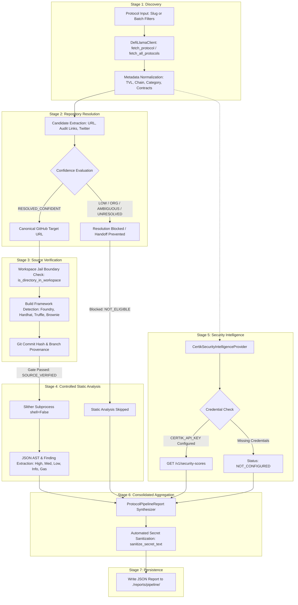

# Project Architecture Overview — DeFi Research & Security Analysis Suite

## 1. System Mission & Architectural Philosophy

The **DeFi Research & Security Analysis Suite** is a modular Python toolkit designed to systematically discover decentralized finance (DeFi) protocols, resolve and verify their canonical smart contract repositories, execute sandboxed static analysis (Slither), retrieve multi-criteria external security ratings (CertiK Skynet), and synthesize the findings into machine-readable audit reports.

### Architectural Core Principles
1. **Pessimistic Trust Model**: External metadata (from aggregators like DefiLlama) and external code repositories cannot be assumed to be authentic or safe. Every transition between pipeline stages is protected by an explicit security gate.
2. **Strict Failure Isolation**: External service outages, rate limits, network failures, missing API credentials, or uninstalled tools must never cause the pipeline or discovery engine to crash. Each stage reports granular, machine-readable outcomes.
3. **No Hidden Assumptions / Honest Data Representation**: Missing security scores, absent audit records, or skipped analyses are recorded as `null` (`None`), never fabricated as `0` or assumed to be clean. Static analysis completion is never described as proof that a contract is secure.
4. **Subprocess & Filesystem Containment**: Untrusted code from external repositories is never executed. Tools like Slither are invoked via `subprocess.Popen(..., shell=False)` within strictly verified workspace boundaries, with zero automated dependency installations or build hooks.
5. **Secret Redaction**: API tokens, Bearer headers, and hex private keys are scrubbed by automated sanitizers before output reaches terminal logs or serialized JSON reports.

---

## 2. Actual System Architecture & Module Map

The codebase is organized under a modular package structure in `src/defi_research/` with unified command-line entry points at the repository root:

```
[ Root Execution Layer ]
  ├── cli.py                    (Interactive console & Unified Subcommand CLI)
  └── config.py                 (Backward-compatible root facade)

[ Core Library: src/defi_research/ ]
  ├── config.py                 (Chain configurations, environment variables, keyword definitions)
  ├── market_intelligence.py    (DefiLlama /protocols API discovery, TVL filtering, EVM address cleaning)
  ├── notrack_script.py         (High-risk sector filtering: Lending, DEXes, Yield, Bridges, Liquid Staking)
  ├── contract_permission_scanner.py (On-chain explorer ABI & source code scanner, modifier regex parser)
  ├── github_repository_resolver.py  (DefiLlamaClient with TTL cache, candidate heuristics, source verifier)
  ├── slither_runner.py         (Sandboxed Slither runner, workspace jail validator, finding parser)
  ├── security_intelligence.py  (CertiK Partner API client, conservative multi-criteria matcher, sanitizer)
  └── pipeline.py               (7-stage end-to-end orchestrator, report serialization, persistence)
```

---

## 3. Data Flow & Integration Topography

The system currently contains **two distinct analysis paths**:

### Path A: The End-to-End 7-Stage Pipeline (`pipeline.py`)

This is the primary automated workflow introduced in Phase 4:



### Path B: On-Chain Explorer Contract Scanner (`contract_permission_scanner.py`)

An independent on-chain inspection path accessible via `cli.py scan` and `market_intelligence.py scan_market_targets`:

```
Contract Address -> Etherscan/BscScan/Polygonscan API (action=getsourcecode)
                 -> Verified ABI & Solidity Source Download
                 -> Regex Extraction of Function Modifiers (onlyOwner, onlyAdmin, etc.)
                 -> Keyword Flagging (withdraw, drain, mint, pause, admin)
                 -> Native Balance Fetch via Web3 RPC + CoinGecko Price -> Approx USD TVL
                 -> Foundry Cast Call Dry-Run Simulation Command Output
```

> [!IMPORTANT]
> **Architectural Finding:** Path B (`contract_permission_scanner.py`) operates directly against explorer APIs and on-chain RPC nodes. It is currently **not integrated into the 7-stage orchestrator** (`pipeline.py`). Unifying Path B into the consolidated pipeline is a major item in the roadmap (Phase 8).

---

## 4. Module Responsibilities & Interfaces

| Module | Core Classes & Functions | Primary Responsibility | Upstream Dependencies | Downstream Consumers |
|---|---|---|---|---|
| `config.py` | `ChainConfig`, `CHAINS`, `ACCESS_MODIFIERS`, `DEFAULT_OUTPUT_DIR` | Global network parameters, RPC URLs, explorer endpoints, env keys. | None (`os.getenv`, `.env`) | All modules |
| `market_intelligence.py` | `clean_contract_address()`, `get_high_value_targets()`, `scan_market_targets()` | Queries DefiLlama `/protocols`, filters by TVL, validates EVM addresses with Web3 checksum. | `requests`, `web3` | `cli.py`, `notrack_script.py` |
| `notrack_script.py` | `resolve_protocol_chain()`, `get_vulnerable_targets()` | Filters DeFi protocols by high-risk categories (Lending, DEX, Yield, Bridges), resolves EVM chain. | `market_intelligence`, `contract_permission_scanner` | `cli.py` |
| `contract_permission_scanner.py` | `ContractScanner`, `analyze_permissions()`, `calculate_approx_tvl()` | Downloads verified ABI/source from block explorers, detects access control modifiers via regex. | `web3`, `requests`, block explorer APIs | `cli.py`, `market_intelligence` |
| `github_repository_resolver.py` | `DefiLlamaClient`, `resolve_github_repository()`, `verify_repository_source()`, `evaluate_slither_eligibility()` | Caching HTTP client for DefiLlama, candidate confidence evaluator, local repository build framework verifier. | `requests`, `config` | `pipeline.py`, `slither_runner.py`, `cli.py` |
| `slither_runner.py` | `run_slither_analysis()`, `check_slither_availability()`, `is_directory_in_workspace()` | Executes Slither CLI in sandboxed subprocess (`shell=False`), validates workspace boundaries, parses findings. | `github_repository_resolver`, `config` | `pipeline.py`, `cli.py` |
| `security_intelligence.py` | `CertikSecurityIntelligenceProvider`, `query_protocol_security_intelligence()`, `sanitize_secret_text()` | Interacts with CertiK Skynet Partner API, matches projects by ID/contract/domain/slug, scrubs credentials. | `requests`, `config` | `pipeline.py`, `cli.py` |
| `pipeline.py` | `run_protocol_pipeline()`, `run_pipeline()`, `save_protocol_report()` | Orchestrates all 7 stages, manages stage handoffs, formats JSON reports, guarantees path containment. | All core modules | `cli.py` |
| `cli.py` | Unified CLI parser, subcommands, interactive menu assistant. | Command-line interface and interactive user workflow. | `pipeline`, all modules | User terminal |

---

## 5. Trust Boundaries & Security Gates

```
[ UNTRUSTED EXTERNAL INTERNET ]
   │  (DefiLlama API, GitHub repos, CertiK API, Block Explorers)
   ▼
[ GATE 1: Input Normalization & Sanity Checking ]
   • clean_contract_address(): Validates 20-byte hex and checksum.
   • DefiLlamaClient: Enforces rate limits, validates JSON structure.
   ▼
[ GATE 2: Repository Resolution Confidence Gate ]
   • ResolutionStatus must be RESOLVED_CONFIDENT for automated handoff.
   • External security scores CANNOT elevate low-confidence resolutions.
   ▼
[ GATE 3: Workspace Jail & Filesystem Boundary ]
   • is_directory_in_workspace(): Canonical path check via os.path.commonpath.
   • Symlinks escaping root are resolved and rejected.
   • Prefix collisions (/workspace_evil vs /workspace) rejected.
   ▼
[ GATE 4: Subprocess Execution Jail (Dual Backend: Native & Docker) ]
   • Native backend: subprocess.run(..., shell=False) with strictly isolated temp files.
   • Docker backend: Docker container execution with:
     - Read-only target volume mount (-v host_dir:/repo:ro)
     - Isolated temporary output volume (-v host_tmp:/output:rw)
     - Total network isolation (--network none)
     - Privilege escalation blocked (--security-opt no-new-privileges)
     - Capability stripping (--cap-drop ALL)
     - Resource caps (--memory 2g, --cpus 2.0)
     - Unprivileged user execution (--user 1000:1000)
   • Zero execution of npm install, arbitrary build scripts, or untrusted repository hooks.
   • Strict timeout enforcement (default 120s).
   ▼
[ GATE 5: Provider Decoupling & Fault Isolation ]
   • Missing API credentials -> NOT_CONFIGURED (never crash).
   • Provider 429/500 errors -> UNAVAILABLE / FAILED (decouple independent stages).
   ▼
[ GATE 6: Output Hygiene & Secret Redaction ]
   • sanitize_secret_text(): Regex scrubs Bearer tokens, API keys, hex private keys.
   • save_protocol_report(): Rejects path traversal in output directory.
   ▼
[ LOCAL FILESYSTEM / CONSOLE OUTPUT ]
```

---

## 6. Status Enums & Lifecycle Mapping

### 6.1 Individual Stage Status (`StageStatus`)
Every pipeline stage returns one of seven standardized machine-readable statuses:

| Status | Meaning | Example Scenario |
|---|---|---|
| `SUCCESS` | Stage completed and fulfilled its primary objective. | Valid DefiLlama metadata resolved, or Slither completed with 0 errors. |
| `SKIPPED` | Stage was intentionally bypassed. | Local source directory not provided, skipping static analysis. |
| `NOT_CONFIGURED` | Required provider credentials or settings are missing. | `CERTIK_API_KEY` is not set in `.env`. |
| `NOT_ELIGIBLE` | Blocked by a security gate. | Repository resolution is `ORGANIZATION_ONLY` or `AMBIGUOUS`. |
| `UNAVAILABLE` | External tool or provider service is missing or unreachable. | Slither is not installed in the operating system `PATH`. |
| `FAILED` | Critical execution failure or malformed payload. | Protocol slug not found on DefiLlama, or internal analysis crash. |
| `PARTIAL` | Completed with limitations. | Provider found audit records but no security score. |

### 6.2 Overall Pipeline Status (`PipelineOverallStatus`)
- `COMPLETED`: All critical stages executed with `SUCCESS`.
- `PARTIAL`: Some stages succeeded while independent optional stages were `SKIPPED`, `NOT_CONFIGURED`, or `UNAVAILABLE`.
- `FAILED`: Critical discovery or repository resolution stages failed.

---

## 7. Reporting & Artifact Schemas

### 7.1 Single-Protocol Schema (`ProtocolPipelineReport`)
Serialized to `./reports/pipeline/pipeline_<slug>_<timestamp>.json`:
- **Identity:** `protocol_name`, `defillama_slug`, `defillama_id`, `chain`, `category`, `tvl`.
- **Timing:** `started_at`, `completed_at`, `duration_seconds`.
- **Lifecycle:** `overall_status` (`COMPLETED`, `PARTIAL`, `FAILED`).
- **Stages:** Keyed dictionary of `StageOutcome` (`discovery`, `repository_resolution`, `source_verification`, `static_analysis`, `security_intelligence`).
- **Repository Details:** `url`, `resolution_status`, `confidence_reason`.
- **Source Verification:** `status`, `analyzed_commit`.
- **Static Analysis:** `status`, `slither_version`, `findings_count`, `findings_summary` (by severity), `diagnostics`.
- **Security Intelligence:** `status`, `security_score` (float or `null`), `security_score_grade`, `certik_project_id`, `audit_count`.
- **Diagnostics:** `errors`, `limitations`.

### 7.2 Batch Run Summary (`PipelineRunSummary`)
Aggregates batch pipeline runs with `total_protocols`, `completed_count`, `partial_count`, `failed_count`, and array of individual protocol reports.

---

## 8. Testing Architecture & Continuous Integration (Phase 7)

### 8.1 Offline Deterministic Test Suite
The repository enforces 100% offline testability. All network queries (DefiLlama, CertiK, CoinGecko, Block Explorers) and subprocess executions (Docker CLI, Slither) are fully mocked in unit tests to guarantee zero network flakiness, sub-second execution, and zero secret leakage.

Test modules breakdown (157 total tests):
- [`tests/test_cli.py`](file:///c:/Users/lxstb/Documents/amm%20pools%20project/scripts%20protocols%20research/tests/test_cli.py): 10 tests verifying argument parsing and subcommand execution.
- [`tests/test_pipeline.py`](file:///c:/Users/lxstb/Documents/amm%20pools%20project/scripts%20protocols%20research/tests/test_pipeline.py): 16 tests verifying 7-stage orchestration, stage failure isolation, and secret sanitization.
- [`tests/test_slither_docker.py`](file:///c:/Users/lxstb/Documents/amm%20pools%20project/scripts%20protocols%20research/tests/test_slither_docker.py): 15 tests covering Docker argument construction, volume mounting, security flags, and error handling.
- [`tests/test_contract_permission_scanner.py`](file:///c:/Users/lxstb/Documents/amm%20pools%20project/scripts%20protocols%20research/tests/test_contract_permission_scanner.py): 13 tests covering ABI analysis, modifier extraction, and TVL estimation.
- [`tests/test_market_intelligence.py`](file:///c:/Users/lxstb/Documents/amm%20pools%20project/scripts%20protocols%20research/tests/test_market_intelligence.py): 10 tests covering address cleaning, chain aliases, and DefiLlama querying.
- [`tests/test_notrack_script.py`](file:///c:/Users/lxstb/Documents/amm%20pools%20project/scripts%20protocols%20research/tests/test_notrack_script.py): 8 tests covering sector filtering and multi-chain resolution.
- [`tests/test_security_intelligence.py`](file:///c:/Users/lxstb/Documents/amm%20pools%20project/scripts%20protocols%20research/tests/test_security_intelligence.py): 31 tests covering CertiK Partner API responses, matching heuristics, and pagination (30 passed, 1 skipped live opt-in).
- [`tests/test_slither_runner.py`](file:///c:/Users/lxstb/Documents/amm%20pools%20project/scripts%20protocols%20research/tests/test_slither_runner.py): 14 tests covering native Slither subprocess execution and finding parsing.
- [`tests/test_slither_security_audit.py`](file:///c:/Users/lxstb/Documents/amm%20pools%20project/scripts%20protocols%20research/tests/test_slither_security_audit.py): 17 tests verifying workspace jail containment, path traversal defense, and secret scrubbing.
- [`tests/test_github_repository_resolver.py`](file:///c:/Users/lxstb/Documents/amm%20pools%20project/scripts%20protocols%20research/tests/test_github_repository_resolver.py): 23 tests verifying repository resolution heuristics and confidence grading.

### 8.2 GitHub Actions CI Pipeline
The automated CI pipeline ([`.github/workflows/ci.yml`](file:///c:/Users/lxstb/Documents/amm%20pools%20project/scripts%20protocols%20research/.github/workflows/ci.yml)) runs on all pull requests and pushes to `main`:
- **Cross-Platform Matrix:** Validates execution across both `ubuntu-latest` and `windows-latest`.
- **Python Compatibility:** Tested on Python `3.10`, `3.11`, and `3.12`.
- **CLI Validation:** Executes all subcommands with `--help` to prevent argument regressions.
- **Offline Reliability:** Guaranteed deterministic pass without requiring external API keys or Docker Desktop.
