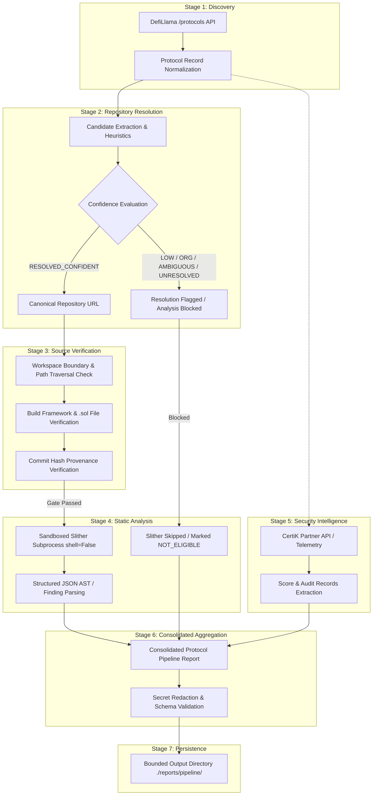

# DeFi Research & Security Analysis Pipeline — Architecture Guide

## Overview

The **DeFi Research & Security Analysis Suite** is a modular Python system designed to discover DeFi protocols, resolve and verify their canonical smart contract repositories, execute isolated static analysis (Slither), retrieve external security ratings (CertiK Skynet), and produce machine-readable, consolidated security reports.

---

## 7-Stage End-to-End Pipeline Data Flow



---

## Security Boundary Gates & Invariants

The architecture enforces strict fail-safe security gates at every transition:

### Gate 1: Source Provenance & Repository Resolution
- **Rule:** Automatic static analysis is strictly prohibited unless repository resolution evaluates to `RESOLVED_CONFIDENT`.
- **Reasoning:** In DeFi, malicious actors frequently create impersonation repositories or outdated forks. DefiLlama metadata containing only organization links (`ORGANIZATION_ONLY`), competing repositories (`AMBIGUOUS`), or non-GitHub links (`UNRESOLVED`) must never be automatically scanned.
- **Independence:** External security intelligence scores (e.g. CertiK) **never** upgrade or bypass a low-confidence repository resolution.

### Gate 2: Workspace Isolation & Path Traversal Defense
- **Rule:** Target directories for source verification and static analysis must reside strictly inside explicitly configured workspace directories (`WORKSPACE_ROOT`).
- **Enforcement:**
  - Resolved canonical paths are compared via `os.path.commonpath` against allowed workspace roots.
  - Prefix collisions (e.g., `/workspace_evil` vs `/workspace`) are rejected.
  - Symlinks escaping workspace boundaries are resolved via `.resolve()` and rejected.
  - Path traversal sequences (`..`) are strictly prohibited.

### Gate 3: Subprocess Sandboxing & Zero Untrusted Execution
- **Rule:** Never execute build scripts or arbitrary code from scanned repositories.
- **Enforcement:**
  - Slither is executed with `subprocess.Popen(..., shell=False)`.
  - No `npm install`, `forge build`, `cargo`, or build hooks are ever triggered automatically.
  - Missing build frameworks or missing dependencies yield `PREREQUISITE_MISSING`, not script execution.
  - Non-zero subprocess exit codes are not assumed to mean vulnerabilities; Slither's structured JSON output is parsed directly.

### Gate 4: Provider Decoupling & Fault Isolation
- **Rule:** External provider outages, network errors, or unconfigured credentials must never crash discovery or the pipeline.
- **Enforcement:**
  - Missing CertiK credentials cleanly result in `StageStatus.NOT_CONFIGURED`.
  - Network timeouts and 429 rate limits are handled with exponential backoff and degrade to `StageStatus.UNAVAILABLE` or `StageStatus.FAILED` for that stage only.
  - Other stages proceed uninterrupted.

### Gate 5: Secret Redaction & Log Hygiene
- **Rule:** No API keys, Bearer tokens, or hex private keys may appear in terminal logs or saved JSON reports.
- **Enforcement:**
  - `sanitize_secret_text()` redacts API keys, secret strings, and 64-char hex private keys matching regex patterns before serializing reports or emitting logs.
  - All report serialization via `.to_json()` runs through automated sanitization.

### Gate 6: Data Integrity & Honest Metrics
- **Rule:** Missing values must be represented as `null` (`None`), never `0`.
- **Enforcement:**
  - An unconfigured or missing CertiK score is stored as `null`. A score of `0.0` represents a failing project, not missing data.
  - Unverified source code is never claimed to be equivalent to deployed on-chain bytecode.
  - Static analysis completion is never described as proof that a protocol is free of vulnerabilities.

---

## Package Structure

```
.
├── cli.py                        # Unified command-line interface & interactive menu
├── config.py                     # Global workspace, network & provider configuration
├── pyproject.toml                # Standard PEP 517/621 packaging metadata
├── requirements.txt              # Production dependency specifications
├── .env.example                  # Sanitized environment variable template
├── .gitignore                    # Git hygiene rules (strictly ignores .env and caches)
├── README.md                     # Comprehensive project documentation
├── docs/
│   ├── architecture.md           # System architecture, data flow & security gates
│   └── reports/                  # Phase implementation & validation reports
│       ├── PHASE1_1_VALIDATION_REPORT.md
│       ├── PHASE1_2_IDENTITY_AND_SOURCE_VERIFICATION_REPORT.md
│       ├── PHASE2_SLITHER_INTEGRATION_REPORT.md
│       ├── PHASE2_1_SECURITY_AUDIT_REPORT.md
│       ├── PHASE3_SECURITY_INTELLIGENCE_REPORT.md
│       └── PHASE3_1_API_VALIDATION_REPORT.md
├── reports/                      # Runtime generated reports directory
│   ├── slither/                  # Raw Slither JSON outputs
│   └── pipeline/                 # Consolidated Phase 4 protocol JSON reports
├── src/
│   └── defi_research/            # Core library package
│       ├── __init__.py           # Package exports & version
│       ├── config.py             # Internal configuration module
│       ├── market_intelligence.py# DefiLlama discovery & market analysis
│       ├── notrack_script.py     # Filtered DeFi sector pipeline
│       ├── contract_permission_scanner.py # EVM on-chain ABI & permission scanner
│       ├── github_repository_resolver.py  # GitHub candidate extractor & resolver
│       ├── slither_runner.py     # Controlled Slither static analysis runner
│       ├── security_intelligence.py       # CertiK Skynet partner API bridge
│       └── pipeline.py           # 7-stage end-to-end pipeline orchestrator
└── tests/
    ├── test_github_repository_resolver.py # Unit tests for GitHub resolution (23 tests)
    ├── test_slither_runner.py             # Unit tests for Slither execution (14 tests)
    ├── test_slither_security_audit.py     # Security audit & path traversal tests (17 tests)
    ├── test_security_intelligence.py      # CertiK provider tests (31 tests)
    └── test_pipeline.py                   # Phase 4 end-to-end pipeline tests (13 tests)
```
